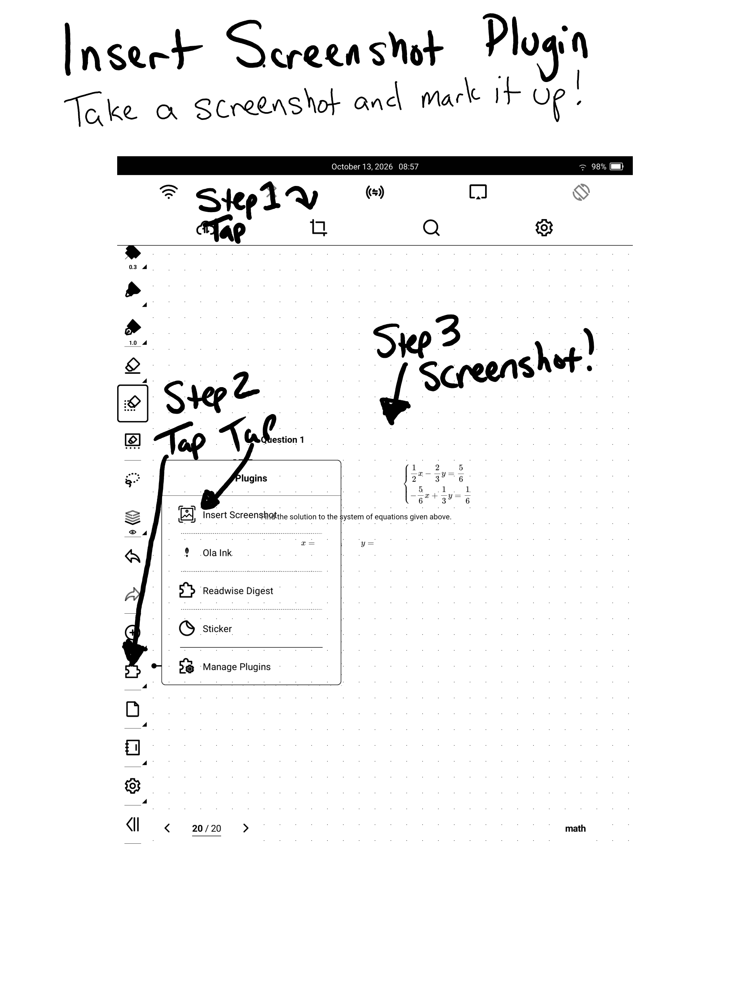

# Insert Screenshot Supernote Plugin

Studying math on my Supernote device is fun. However, if I am working on a
problem I would like to be able to screenshot the book or website and insert
that screenshot into the currently open note as quickly as possible.

So, I wrote this plugin to do that.

## My workflow

1. Open Math Academy in einkbro web browser
2. Read/study at mathacademy.com/learn
3. Screenshot a quiz problem using the Supernote top-bar Screenshot tool
4. Open Supernote sidebar, tap "Last Opened Note"
5. Tap "Insert Screenshot" plugin in the note
6. Crop the screenshot as needed and insert
7. Solve the problem while referring to the screenshot in the note

This plugin prefers speed: 

- the plugin's default action pulls up the most recent image in the SCREENSHOT
  folder for cropping without dialog boxes

- the crop tool is a two tap tool: tap the top left then tap the bottom right
  because dragging handles on eink is slow and choppy

## Install

1. [Download the latest release](https://github.com/philips/supernote-insert-screenshot-plugin/releases)
2. Follow [Supernote Plugin install directions](https://docs.supernote.com/en/first-plugin#install-the-plugin)
